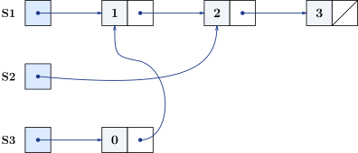

# Listy

## Funkcyjne struktury danych
    
Efektywność wielu struktur danych bazuje na możliwości zmiany stanu. Tak jest choćby w przypadku tablic.
Jest to jeden z powodów tego, że techniki funkcyjne nie do wszystkiego są dobrym wyborem. Struktury danych używane w programowaniu funkcyjnym muszą umożliwiać efektywne operacje mimo braku możliwości zmiany stanu. Operacje, które w językach imperatywnych implementowane są za pomocą zmiany stanu, w językach funkcyjnych tworzą nowe wersje danych bez niszczenia starych wersji. Są to tzw. **trwałe struktury danych** (ang. *persistent data structures*).

Poniższy przykład pokazuje możliwość współdzielenia danych dla list trzech list
- pierwsza zawiera elementy 1, 2 i 3,
- druga &mdash; 2 i 3,
- trzecia &mdash; 0, 1, 2 i 3.




## Model listy w językach funkcyjnych

Na dalszych wykładach omówione będą różne mechanizmy Haskella umożliwiające definiowanie własnych typów danych. Tutaj omówiona będzie podstawowa struktura danych pasującą do przetwarzania funkcyjnego czyli **lista**. Definicja i składnia listy jest wbudowana w język Haskell.

W językach funkcyjnych model listy i sposób przetwarzania list może różnić się od wyobrażenia o liście znanego z innych języków (Python, Java).

Lista jest, podobnie jak w innych językach, sekwencją elementów. W językach statycznie typowanych zwykle wszystkie elementy listy muszą być tego samego typu.

### Definicja i podstawowa składnia listy

#### Definicja

Lista w językach funkcyjnych jest zdefiniowana rekurencyjnie.
Mamy dwa przypadki.
- Lista może być pusta. 

- Lista może być parą złożoną z:
    - Pierwszego elementu listy nazywanego **głową** (ang. *head*).
    - Reszty listy nazywanej **ogonem** (ang. *tail*). Ogon listy jest listą.

    Np. drugi element listy jest głową ogona listy, trzeci element jest głową ogona ogona listy, lista bez pierwszych dwóch elementów jest ogonem ogona listy, itp.


#### Składnia:

- Pustą listę zapisujemy jako `[]`.
- Listę złożoną z głowy `h` i ogona `t` zapisujemy jako `h:t`.

Zatem np. listę złożoną z elementów `1`, `2`, `3` i `4` możemy zapisać jako
```haskell
1:(2:(3:(4:[])))
```

Nie jest to zbyt wygodny i czytelny zapis, ale:
- operator jest *prawostronnie łączny* czyli możemy to zapisać pomijając nawiasy
    ```haskell
    1:2:3:4:[]
    ```
- Haskell ma specjalną prostszą składnię dla list. Powyższa lista może być zapisana po prostu jako:
    ```haskell
    [1,2,3,4]
    ```
    Ta składnia trochę chowa fakt rzeczywistej struktury listy. Należy pamiętać, że jest to tzw. **lukier składniowy** (ang. *syntactic sugar*) i że w dalszym ciągu jest to po prostu para:
    - głową tej listy jest liczba `1`,
    - ogonem tej listy jest lista `[2,3,4]`.
    
    Zatem listę tę możemy też zapisać np. jako `1:[2,3,4]`

#### Typ listy

Typ listy elementów typu `a` zapisujemy jako `[a]`

**Uwaga:** Głowa i ogon listy mają różny typ. Ogon listy jest tego samego typu co cała lista. Jeżeli głowa ma typ `a`, to typem ogona jest lista elementów typu `a` czyli `[a]`. Np. lista `[1,2,3,4] :: [Int]` ma:
- głowę `1 :: Int`,
- ogon `[2,3,4] :: Int`.


#### Napisy

Napisy są w Haskellu po prostu listami znaków. Typ `String` jest po prostu tzw. aliasem (inną nazwą) typu `[Char]`. Takie aliasy można łatwo samemu definiować za pomocą `type`. Np. typ `String` jest zdefiniowany jako `type String = [Char]`.

Zapis `"abcd"` jest prostszym zapisem listy `['a','b','c','d']`, czyli `'a':('b':('c':('d':[])))`.

#### Przydatne konstrukcje językowe związane z listami

- *List comprehension*:
    ```haskell
    ghci> [x^2 | x <- [1,2,3,4]]
    [1,4,9,16]
    ghci> [x^2 | x <- [1,2,3,4,5,6,7,8], x > 3]
    [16,25,36,49,64]
    ```
* Listy zdefiniowane z podaniem zakresu:
    ```haskell
    ghci> [1..9]
    [1,2,3,4,5,6,7,8,9]
    ghci> [1,3..9]
    [1,3,5,7,9]
    ghci> [1,3..8]
    [1,3,5,7]
    ghci> ['a'..'e']
    "abcde"
    ghci> ['a','c'..'e']
    "ace"
    ```
    Zakresy są uproszczoną skłądnią dla wywołań funkcji `enumFromTo` i `enumFromThenTo` z sygnaturami:
    ```haskell
    enumFromTo :: Enum a => a -> a -> [a]
    enumFromThenTo :: Enum a => a -> a -> a -> [a]
    ```

## Przetwarzanie list

Przetwarzanie list bardzo często wymaga wywołań rekurencyjnych dla części listy (zwykle ogona). Głowę listy i ogon listy można uzyskać za pomocą funkcji:
- `head :: [a] -> a`,
- `tail :: [a] -> [a]`.

### Wzorce
W praktyce tych funkcji używa się rzadko i do dostępu do części listy używa się *dopasowania wzorców* (ang. **pattern matching**).
Użycie wzorców może służyć do rozpoznania wartości i struktury argumentu.

Przykładowa implementacja `head` i `tail` z użyciem wzorców:
```haskell
head (h:t) = h

tail (h:t) = t
```
**Uwaga:** Jeżeli chcemy przedefiniować funkcje z modułu `Prelude` możemy na początku pliku użyć deklaracji importującej moduł chowającej wybrane elementy: np. dla schowania funkcji `head`, `tail` i operatora `++` (omówionego dalej):
```haskell
import Prelude hiding (head,tail,(++))
```

**Uwaga:** To przykłądy tzw. **częściowych funkcji** (ang. *partial function*). Nie są zdefiniowane dla list pustych. Możemy je też zdefiniować dla brakujących wzorców, ale jawnie użyć funkcji `error`: Elementy wzorca nieużywane w definicji można zastąpić znakiem podkreślenia:
```haskell
head [] = error "Lista jest pusta!"
head (h:_) = h

tail [] = error "Lista jest pusta!"
tail (_:t) = t
```

**Pytanie:** Dlaczego odpowiedniki `head` i `tail` zwracające odpowiednio ostatni element listy i wszystkie elementy oprócz ostatniego, czyli `last` i `init` nie są aż tak ważne w kontekście przetwarzania list i rzadko są używane?


#### Przykład użycia wzorców:

Chcemy wyciągnąć pierwsze trzy elementy z dowolnej listy, która ma co najmniej trzy elementy, za pomocą odpowiedniego wzorca.
- Dlaczego `f [x1,x2,x3] = ...` się tu nie sprawdzi?

    Ten wzorzec oznacza to samo co `f (x1:x2:x3:[]) = ...` czyli listę **dokładnie** trójelementową a nie co najmniej trójelementową.
- Czy `f (x1:x2:x3:t) = ...` zadziała dla list, które mają dokładnie trzy elementy? Jeżeli tak, to do czego dopasuje się wtedy `t`?

    Wywołanie `f [1,2,3]` oznacza to samo co `f (1:2:3:[])`, czyli `t` dopasuje się do listy pustej.

### Operacje na listach

TODO: uzupełnić

Poniżej przedstawione są przykłady podstawowych operacji na listach z przykładowymi sposobami implementacji:

- obliczenie długości listy (`length` z `Prelude`),

    ```haskell
    length = ...
    ```

- element o zadanym indeksie (operator `!!` z `Prelude`),
- dodanie elementu na początek listy,
- dodanie elementu na koniec listy,
- konkatenacja (połączenie) dwóch list (operator `++` z `Prelude`),
- odwrócenie listy (funkcja `reverse` z `Prelude`).


### Operacje na listach a implementacja efektywnych struktur danych

Przykłady operacji modyfikujących listę (oczywiście operacje nie mogą niczego naprawdę zmodyfikować &mdash; zwracają nową listę):
- wstawienie elementu na początek listy: brak potrzeby kopiowania danych, czas stały,
- usunięcie elementu z początku listy: brak potrzeby kopiowania danych, czas stały,
- wstawienie elementu na koniec listy: konieczność skopiowania całej listy, czas liniowy,
- usunięcie elementu z końca listy: konieczność skopiowania całej listy, czas liniowy.

Jako przykład weźmy podstawowe abstrakcyjne struktury danych takie jak **stos** (ang. *stack*, *LIFO* &mdash; *last in, first out*) i **kolejka** (ang. *queue*, *FIFO* &mdash; *first in, first out*) i zastanówmy się nad ich implementacją. Obie te struktury są często implementowane w językach imperatywnych jako **lista wiązana** (ang. *linked list)*. 

Jak mają się te struktury danych do list w językach funkcyjnych i co to oznacza dla kwestii implementacji funkcyjnego stosu i kolejki?

Stos można efektywnie zaimplementować jako za pomocą **listy wiązanej jednokierunkowej** (ang. *singly linked list)* z operacjami wyłącznie na początku listy. Przekłada się to bezpośrednio na podstawowe operacje na liście:
- Wierzchołek stosu to głowa listy.
- Stos po zdjęciu elementu z wierzchołka to ogon listy.
- Odłożenie elementu na stos oznacza skonstruowanie listy, w której głową jest ten element, a ogonem lista reprezentująca resztę stosu (stos przed dodaniem elementu).

Do implementacji kolejki używa się zwykle **listy wiązanej dwukierunkowej** (ang. *doubly linked list*) i operacji na obu końcach listy.
- Jeżeli użyjemy listy jednokierunkowej, to złożoność operacji na jednym z końców będzie liniowa a nie stała.
- Nie da się skonstruować struktury takiej jak lista dwukierunkowa bez zmiany stanu (instrukcji podstawienia).

Efektywna funkcyjna implementacja kolejki wymaga nieco więcej sprytu, wymaga dwóch list i operacje na niej mają **amortyzowaną** złożoność stałą.

### Listy wielowymiarowe

Listy wielowymiarowe są po prostu listami list, np.
```haskell
[[1,2,3],[],[1,2]] :: [[Int]]
```

